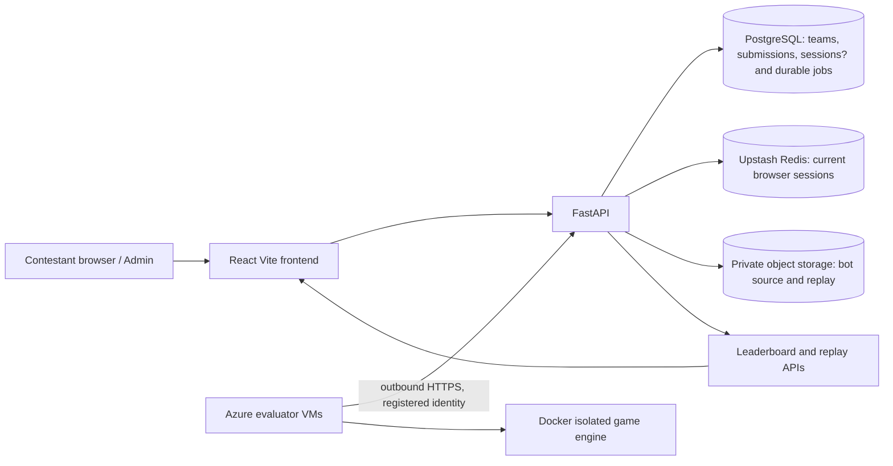

# FarmCraft Azure primary / Render backup — Phase 1 audit

Date: 2026-10-11. This is a read-only deployment audit and staged plan. No Azure control-plane resource, extra VM, budget, or production routing was created or changed for this phase.

## Current verified state

- The Azure for Students subscription is enabled. Resource group `rg-farmcraft-staging` contains the existing Korea Central `Standard_D2as_v4` evaluator VM, its 32 GiB Standard LRS OS disk, static Standard public IP, NIC, VNet, NSG, SSH public key and an access extension. It has **no** Azure PostgreSQL, Container App, Static Web App, registry, or Blob account. `az consumption budget list` returned no budgets.
- Korea Central VM quota: 2 of 6 regional vCPUs and 2 of 4 DAsv4-family vCPUs used. DSv4-family usage is 0 of 4. Indonesia Central: 0 of 6 regional, 0 of 4 DAsv4-family vCPUs used. Catalogue and quota do **not** prove allocation or subscription permission.
- Render's existing frontend and API remain deployed. The API is live on commit `58ec9923486b240599ad4ece623736c63524934e`; `/ready` returned 200 with database, Redis, and storage healthy. The API now uses the new Neon `farmcraft-control-plane-v2` database and private bucket. The quota-blocked original Neon `farmcraft-control-plane` and its historical 16 published qualifiers remain untouched as an archive. The new event database was `SETUP` with no official or tournament games at the last check. Both existing Azure evaluator services were registered to the new database, running at one concurrent job each, and a real sandbox job completed.
- The repository's `azure/` templates are expressly marked **archived**. They default to UAE North, create a Standard ACR and a VNet-connected Container Apps environment, bundle the React build into the API image, omit a deployed PostgreSQL server from the base stack, configure PostgreSQL sessions, and set API minimum replicas to zero. They are a starting reference, not a deployable approved production plan. `azure-workers/` is the active VM path and must be preserved.

## Application flow and dependencies

The API creates its SQLAlchemy engine and schema at import from `DATABASE_URL`; startup recovers jobs. `QUEUE_BACKEND=postgres` commits durable jobs to PostgreSQL. Azure workers authenticate by scoped credentials stored in that database, claim jobs with PostgreSQL row locking and attempt IDs, then report progress/results and upload replays through the API. The API owns the database and object-storage credentials; worker VMs have neither. Official submissions freeze the source hash, reference versions and evaluation config; the qualification leaderboard reads completed official result JSON. `ADMIN_PASSWORD_HASH` and `ADMIN_SESSION_SECRET` protect organizer routes; participant/admin browser sessions currently use Upstash. Production cookies are Secure, HttpOnly and SameSite=None, with CSRF headers for writes.

Key files: `backend/main.py`, `backend/admin.py`, `backend/remote_workers.py`, `backend/services/{storage,queueing,blob_storage,evaluation,scoring,participants}.py`, `backend/jobs.py`, `backend/worker.py`, `frontend/src/{participantApi,App,Lab,AdminApp}.jsx`, `farmcraft-evaluator/app/{worker,runner}.py`, `azure-workers/`, `render.yaml`, `azure/`, and `requirements-api.txt`.

## Findings that affect migration

1. **Database transfer:** The old project's 9.47 GB transfer is observed, but no query-level byte attribution was available. The deployed commit replaced full `SimulationJob` fetches in frequent admin metrics with narrow projections and removed a per-team strategy read. Remaining candidates: `list_jobs()` and `list_admin_jobs()` load full result JSON; live qualification leaderboard loads every completed official job/result; admin overview polls every 5 seconds; the public overview polls at 3 or 15 seconds; the active job page uses both SSE and a 5-second GET; participant heartbeats write every configured interval and remote workers poll/heartbeat. Record request rates, SQL statement counts and selected bytes in an isolated rehearsal before attributing the quota overrun or claiming a measured improvement.
2. **Frontend routing:** Render rewrites `/api`, `/jobs`, `/teams`, `/sandbox`, `/replays`, `/tournament`, `/players`, etc. The React app defaults to same-origin paths. Azure Static Web Apps' Container Apps integration proxies only `/api/*` and [requires Standard](https://learn.microsoft.com/en-us/azure/static-web-apps/apis-container-apps). A direct cross-origin `VITE_API_BASE` can make Secure SameSite=None cookies dependent on browser third-party-cookie policy. Choose and browser-test a same-origin route design before cutover. A short-term low-risk option is the existing bundled React/FastAPI container; a separate Static Web App needs compatible `/api` path aliases or an approved proxy design. Keep Render unchanged during this work.
3. **Existing Azure template gaps:** `azure/application.bicep` has no readiness probe, uses `minReplicas: 0`, and switches to PostgreSQL sessions even though Upstash already works, potentially increasing DB traffic. Its secret parameters need a secure injection method. `azure/control-plane.bicep` provisions Standard ACR and networking without a costed approval. `azure/database.bicep` references existing network resources and cannot by itself prove this subscription will create a server. Rework in a dedicated migration branch and preview with `what-if` before any create.
4. **Blob portability:** `AzureBlobStorage` already uses managed identity, private HTTPS container access, key validation and a 64 MiB read/write limit. It needs a measured upload/replay probe and a Render fallback credential/replication design; managed identity does not work on Render. Old and new S3 buckets must remain intact.
5. **Worker endpoint:** Both active Azure services target the Render API. Their credentials are tied to the new Neon DB. A new Azure DB needs new one-use registrations, staged credentials and a controlled endpoint switch. Keep only one environment dispatching official jobs. Retain the current VM and its pre-v2 credential archives.
6. **Competition format:** Backend request validation allows only 5–10 references; storage explicitly accepts only 5 or 10; Admin offers 5 or 10. Three references and one seed would produce exactly six side-swapped games, but the option is not implemented. One official attempt is already enforced. Add 3 across these layers with tests before an Azure rehearsal; do not change game/scoring code or start Round 1.

## Feasibility and price checkpoint

Read-only SKU output lists PostgreSQL Flexible Server B1ms in Korea Central, but past create attempts failed; actual permission/capacity remains **unverified**. No new paid resource is approved by this audit. Pricing below is public USD retail as queried on 2026-10-11 from the [Azure Retail Prices API](https://learn.microsoft.com/en-us/rest/api/cost-management/retail-prices/azure-retail-prices), before student credit, tax, bandwidth, disks, IPs, monitoring, backups, registry and discounts. Approximate INR uses ₹96.6/USD from the [NSE's latest available reference table](https://www.nseindia.com/report-detail/rbi-reference-rate-statistics). It is an estimate, not the subscription invoice.

| Item | Observed retail meter | 730-hour month | 3-hour event |
| --- | ---: | ---: | ---: |
| Existing Korea D2as v4 compute | $0.118/hour | $86.14 (₹8,321) | $0.35 (₹34) |
| Proposed Korea D4s v4 compute | $0.236/hour | $172.28 (₹16,644) | $0.71 (₹68) |
| Proposed Indonesia D4as v4 compute | $0.216/hour | $157.68 (₹15,233) | $0.65 (₹63) |
| Korea PostgreSQL B1ms compute + 32 GB provisioned storage | $0.026/hour + $0.131/GB-month | about $23.17 (₹2,238) | about $0.10 (₹10), assuming storage retained all month |
| Korea PostgreSQL B2s compute + 32 GB provisioned storage | $0.104/hour + $0.131/GB-month | about $80.11 (₹7,739) | about $0.33 (₹32), assuming storage retained all month |

The three proposed VM sizes together are $0.57/hour, about $1.71 (₹165) for three hours of **compute only**. Leaving all three on for 730 hours would cost about $416 (₹40,198) in VM compute alone; deallocate optional VMs after the event. Existing disk and static IP keep charging when the VM is deallocated. [Stopped PostgreSQL continues charging for storage and retained backups](https://learn.microsoft.com/en-us/azure/postgresql/backup-restore/concepts-backup-restore). A 0.5-vCPU/1-GiB Container App active around the clock has a raw Korea retail usage estimate around $39/month before the [monthly consumption free grants](https://learn.microsoft.com/en-us/azure/container-apps/billing); actual billing depends on idle time, replicas, requests, networking and subscription eligibility. Static Web Apps Free has [100 GB included bandwidth](https://learn.microsoft.com/en-us/azure/static-web-apps/quotas), but linked Container Apps requires a paid Standard plan. ACR, Blob transactions/storage, logs, egress, public IP, and backup charges still need a final Azure calculator/what-if estimate. Azure for Students has finite credit and [spending-limit behavior](https://learn.microsoft.com/en-us/azure/cost-management-billing/manage/spending-limit); no budget alert currently exists in the resource group.

## Capacity math, not a benchmark

The target is 180 full 720-step games in 900 seconds. At the historical 26–38 seconds/game, 10 concurrent single-job slots with six sequential games/job and 30 jobs imply three waves: **468–684 seconds** of match runtime in an ideal evenly scheduled system. This leaves 216 seconds at the slow end for startup, network, scoring, replay upload, retries and skew. Two current slots imply roughly 2,340–3,420 seconds before overhead. Neither figure proves the 15-minute target. The proposed Korea D4s v4 would consume all remaining regional cores (6/6 total with the existing VM); the Indonesia D4as v4 fits its listed 4/4 family and 4/6 regional quota but actual allocation and latency are unverified. Do not buy these VMs before a real isolated benchmark.

## Recommended stages and gates

1. **Phase 1 review (now):** confirm the target event, allowed student-credit spend, domain/routing preference, and backup recovery objectives. Preserve Render/Neon and all live records. Review the itemized Azure estimate and SKU availability. No provisioning.
2. **Local preparation:** create a dedicated migration branch; refactor status/list projections and polling using measured query counts and bytes; add three-reference support; build a production API image and reproducible Bicep with explicit `what-if`, probes, secret handling and safe resource names. Keep the current branch deployable. Run local tests and an isolated benchmark, never consume a live official attempt.
3. **Azure staging approval:** only after a priced plan, request explicit approval for specific resources, region, SKU, monthly cap/credit budget and shutdown date. Provision a fresh Azure database, private Blob container, API and frontend route solution; retain Render and old Neon untouched. Verify actual API readiness and browser auth/upload/replay flows.
4. **Performance gate:** register workers to the Azure staging database with new credentials, then run 30 independent full bots and 180 actual games. Record p50/p95/p99, queue wait, DB transfer, resource use and cost. Revise sizing only from measured results.
5. **Primary cutover approval:** request a separate explicit approval. Drain old worker claims, take a consistent PostgreSQL and object-storage recovery point, switch one authoritative writer and participant URL, then reopen workers on Azure. Never run active-active official queues.
6. **Render fallback:** first implement and rehearse application failover using the same authoritative database/storage (Level A) with Render standby writes disabled until a controlled switch. This does **not** survive Azure DB failure. Add Level B only after verifying affordable independent DB and object backups, restore speed and integrity. The old quota-blocked Neon project is an archive, not a ready replica. Document RPO/RTO and manually test failover/failback with synthetic staging records.

## Approval boundary

No resource creation, spending, production configuration change, worker endpoint change, or traffic switch follows from this Phase 1 audit. The next decision is approval of a priced **staging** design after the frontend routing and PostgreSQL subscription feasibility are resolved. Historical 16 qualifiers and the current Render services remain preserved.
